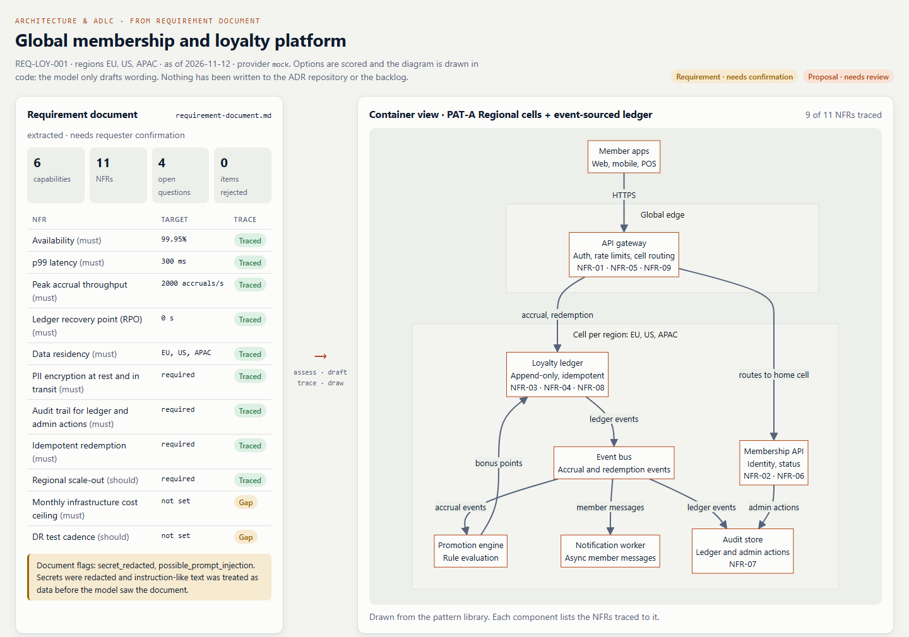

# Use case 3 · Architecture & ADLC

_Author: Pradeep Sahoo_ · package `ecc-architecture` (`ecc_architecture`) · depends on `ecc-core` only

From a structured requirement, or a requirement document, it scores reference patterns against
every NFR, ranks the options, flags conflicts with accepted ADRs and raises open questions. It
drafts an ADR and user stories, traces each NFR to a component, ADRs and stories, and draws a
container diagram of the preferred option. Everything goes to a proposal pack for approval. Why
and how: root README [section 5.3](../../README.md#53-use-case-3--architecture--adlc).



## Commands

```bash
python ecc.py architecture ingest use-cases/architecture-adlc/data/synthetic/requirement-document.md
python ecc.py architecture run --requirement-doc use-cases/architecture-adlc/data/synthetic/requirement-document.md
#   -> runs/architecture/proposal/REQ-LOY-001.html: open in a browser
python ecc.py architecture evaluate                 # from requirement.json; add --requirement-doc to start from the document
python ecc.py architecture feedback ADR-007 --accept yes --by arb.chair
python ecc.py architecture report
python scripts/screenshots.py architecture  # regenerate the screenshot above (needs Edge or Chrome)
```

Add `--provider claude` to `ingest`, `run` or `evaluate` to use Claude. Outputs go to
`runs/architecture/` (override with `ecc architecture --workdir DIR ...`).

## Configuration · `[use_cases.architecture]`

| Key | Default | Meaning |
|-----|---------|---------|
| `paths.arch_dir` | — | Requirement, requirement document, pattern library, ADRs, labels |
| `settings.availability_margin` | 0.05 | Availability within this many points below target is at risk |
| `settings.latency_margin` | 1.2 | Latency up to 20% over target is at risk |
| `settings.throughput_margin` | 0.8 | Throughput of at least 80% of target is at risk |
| `settings.mermaid_url` | pinned CDN | Diagram renderer loaded by the proposal page |
| `gates.*` | see config | Assessment accuracy, preferred option, NFR trace recall, rejected drafts, invented figures, diagram issues |

## Code map

| Path | Role |
|------|------|
| `src/ecc_architecture/__init__.py` | `USE_CASE`, and the Claude adapter (drafting + extraction) on `ecc_core.llm` |
| `src/ecc_architecture/cli.py` | Commands under `ecc architecture` |
| `src/ecc_architecture/sources.py` | Read-only requirement, pattern library and ADR sources |
| `src/ecc_architecture/intake.py` | Requirement document → structured requirement; quote and figure checks |
| `src/ecc_architecture/assess.py` | Option-by-NFR rules (`Rules`), ranking, ADR conflicts, open questions, traceability |
| `src/ecc_architecture/drafting.py` | ADR and story schema, mock drafter, validation including invented figures |
| `src/ecc_architecture/diagram.py` | Mermaid container diagram, labelled with traced NFRs |
| `src/ecc_architecture/html.py` | Proposal page: requirement document and rendered diagram side by side |
| `src/ecc_architecture/review.py` | Run, proposal pack, approver feedback, evaluation |
| `data/synthetic/` | Requirement (JSON and document), patterns, ADRs, labels |
| `reports/` | [evaluation](reports/architecture-evaluation-mock.md) · [proposal](reports/architecture-proposal-REQ-LOY-001.md) · [page](reports/architecture-proposal-REQ-LOY-001.html) · [diagram](reports/architecture-container-REQ-LOY-001.mmd) |
