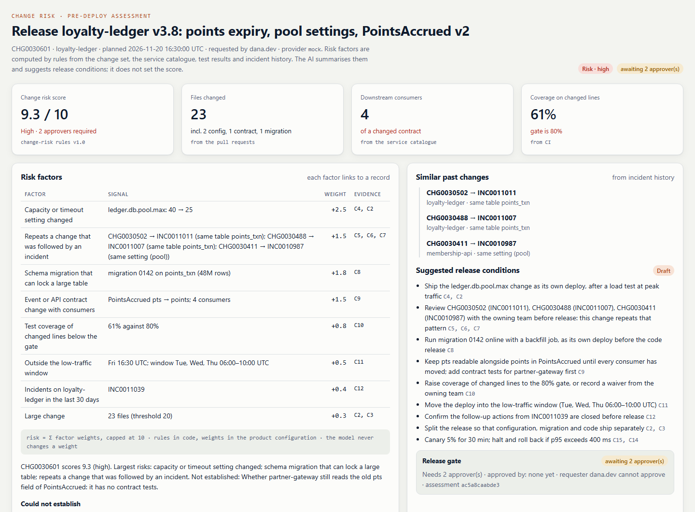

# Use case 4 · Change risk (pre-deploy assessment)

_Author: Pradeep Sahoo_ · package `ecc-change` (`ecc_change`) · depends on `ecc-core` only

Scores a change before it ships, from rule-based factors computed in code. It finds similar past
changes that were followed by incidents, has the model explain the risk and draft release
conditions, and gates the release: a high score needs two approvers, and the person who requested
the change cannot approve it. Why and how: root README
[section 5.4](../../README.md#54-use-case-4--change-risk).



## Commands

```bash
python ecc.py change assess                          # every upcoming change (or name them: assess CHG0030601)
#   -> runs/change/reports/CHG0030601.html: open in a browser
python ecc.py change approve CHG0030601 --by lee.lead --role release-manager
python ecc.py change approve CHG0030601 --by priya.sre --role sre-lead      # a high score needs a second approver
python ecc.py change approve CHG0030603 --by lee.lead --role engineering-lead --reject --note "split the migration"
python ecc.py change status                          # gate state of every assessed change
python ecc.py change backtest                        # past changes scored as of their start vs what followed
python scripts/screenshots.py change                 # regenerate the screenshot above (needs Edge or Chrome)
```

Add `--provider claude` to `assess` to draft conditions with Claude. Outputs go to `runs/change/`
(override with `ecc change --workdir DIR ...`).

## Risk factors

Score = sum of the weights of the factors that fire, capped at 10. Low below 3, medium from 3,
high from 7. Each factor cites evidence records (C1, C2, ...).

| Factor | Fires when | Default weight |
|--------|-----------|----------------|
| `sensitive_config` | A capacity or timeout setting changed (pool, max, limit, replica, thread, connection, timeout, memory) | 2.5 |
| `capacity_cut` | ...and a capacity setting was cut by at least half | +1.0 |
| `repeat_pattern` | The change shares a capacity setting, table or contract with a past change that was followed by an incident, as known at assessment time | 1.5 |
| `migration_blocking` / `migration_online` | A migration that can lock a large table (non-null column, not online), or an online one | 1.8 / 0.6 |
| `unindexed_query` | A new query on a large table not covered by an index | 1.8 |
| `contract_change` | An event or API contract field renamed or removed: 0.5 + 0.25 per consumer, up to 1.5 | ≤ 1.5 |
| `coverage_gap` | Coverage of changed lines below the gate (80%) | 0.8 |
| `deploy_window` / `freeze` | Outside the low-traffic window / inside a change freeze | 0.5 / 2.0 |
| `recent_instability` | Incidents on the same service in the last 30 days | 0.4 |
| `no_rollback` | No runbook covers the service, or its runbook is stale or never validated | 0.5 |
| `change_size` | More than 20 files | 0.3 |

**Could not establish** lists what the sources can't show, for example a consumer with no contract
tests, a change with no coverage report, or a runbook whose state on a past date is unknown.

## Release gate (in code, not configuration)

- Low or medium: one approver. High: two different approvers.
- The requester cannot approve, an agent can never approve, and approvers need the role
  `release-manager`, `engineering-lead` or `sre-lead`.
- Any rejection blocks the release.
- Approvals are tied to one assessment ID. Editing the change, or the rules, gives a new ID, and
  earlier approvals stop counting.
- The gate records the decision; nothing here deploys or blocks a pipeline.

## Configuration · `[use_cases.change]`

| Key | Meaning |
|-----|---------|
| `paths.changesets_dir` | One file per change: pull requests, config diffs, migrations, queries, contract changes, coverage |
| `paths.calendar` | Low-traffic windows, freezes, release policy (canary size and duration) |
| `settings.weight_*` | The weights above |
| `settings.medium_min`, `high_min` | Band thresholds |
| `settings.*` | `capacity_cut_ratio`, `large_table_rows`, `coverage_gate_pct`, `instability_days`, `runbook_stale_days`, `change_size_files`, `outcome_window_hours`, `as_of` |
| `gates.*` | Backtest recall and false-alarm rate, rejected conditions, invented figures |

Changes and incident history come from `[connectors.servicenow]`; the service catalogue and
runbooks from `[sources]`.

## Code map

| Path | Role |
|------|------|
| `src/ecc_change/__init__.py` | `USE_CASE`, and the Claude drafter on `ecc_core.llm` |
| `src/ecc_change/cli.py` | Commands under `ecc change` |
| `src/ecc_change/sources.py` | Read-only inputs: ServiceNow changes and incidents, change sets, catalogue, calendar, runbooks |
| `src/ecc_change/factors.py` | The factor rules, `Rules`, the score and bands, similar past changes |
| `src/ecc_change/drafting.py` | Conditions schema and prompt, mock drafter, validation |
| `src/ecc_change/gate.py` | Release gate: approvers, two-person rule, decisions, status |
| `src/ecc_change/review.py` | Assess, reports, backtest |
| `src/ecc_change/html.py` | The risk report page |
| `data/synthetic/` | Change sets, release calendar, labels |
| `reports/` | [`change-risk-CHG0030601.md`](reports/change-risk-CHG0030601.md) · [page](reports/change-risk-CHG0030601.html) · [`backtest-mock.md`](reports/backtest-mock.md) |
