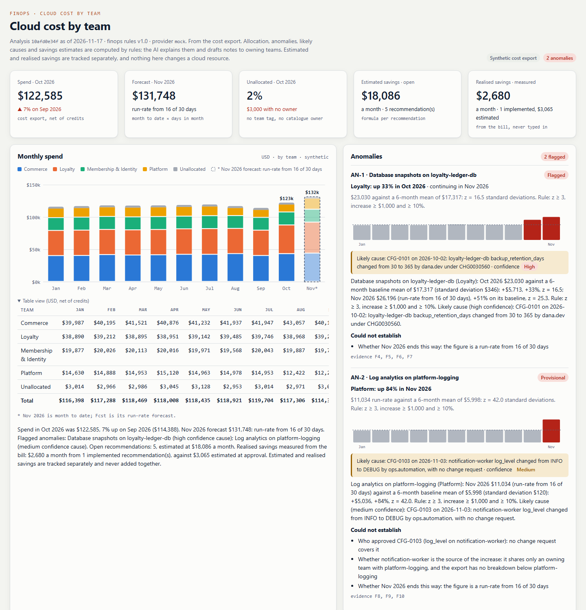

# Use case 5 · FinOps (cloud cost by team)

_Author: Pradeep Sahoo_ · package `ecc-finops` (`ecc_finops`) · depends on `ecc-core` only

Reads the cloud cost export (FOCUS, AWS CUR 2.0 or Azure cost details), allocates it to teams and
shows amortised monthly spend by team with a month-end forecast. It flags statistically unusual
increases with their likely cause and a confidence level, raises daily alerts within days of a
step change, tracks reservations and savings plans, and proposes savings. Estimated and realised savings go in separate columns: the estimate comes from
a formula in code, and the realised saving is measured from the bill after the change. The
owning team decides every recommendation (checked against the team directory), and nothing here
changes a cloud resource. Why and how:
root README [section 5.5](../../README.md#55-use-case-5--finops).



## Tagging agent (proposes only)

`ecc finops tags check` reads every cloud resource (`inventory.json`, or the output of
`aws resourcegroupstaggingapi get-resources` or an Azure Resource Graph query) and checks it
against the tag policy:

- every resource needs `team` (a known team) and `env` (prod, staging, dev, sandbox);
- a production resource that is not shared needs `service` (a catalogue service);
- shared infrastructure carries `shared=true`;
- keys are lower case: `Team` and `Environment` are proposed for removal once `team` and `env` are set.

Each proposed value is scored by rules with the parts shown: a team-like tag naming a known
team with a different case or key +3, the catalogue owner of the service tag +3 (+2 when the
service is inferred from the name), the account's owning team +1, the creator's team +1; for
`env`, an alias such as `Production` +3, the account's environment +2, a word in the name +2. High
from 3, medium 2; low or conflicting values are not proposed but reported for a person to answer.

The team the resource would belong to approves each proposal (an active `service-owner` or
`engineering-lead` in the team directory). A resource with no team that can be established
"needs owner": nobody can approve it until its owner is set. `ecc finops tags plan` writes the
approved changes as `aws resourcegroupstaggingapi` / `az tag update` commands for the team to run
through its own change process. **This system never runs them**; the audit log records proposals
and decisions, and the evaluation requires zero cloud changes. An approval holds only while the
proposal is unchanged.

## Cost by team dashboard

`ecc finops dashboard` writes `runs/finops/dashboard.html` ([sample](reports/cost-by-team-dashboard.html)),
a self-contained page that recomputes in the browser:

| Control | Choices |
|---|---|
| View | today's tags · with approved tag proposals · with all tag proposals |
| Cost basis | amortised · billed (invoice) |
| Months, environments, categories | any range and subset |
| Shared costs | own row · split evenly · split by each team's direct cost · fixed percentages; optionally treat unallocated cost as shared |
| Budgets | monthly per team (from `budgets.json`), editable; compared with the latest month or the partial month's forecast |

Settings stay in the viewer's browser (and in the link: `#view=proposed&split=even`). "Copy as
configuration" shows the TOML and budgets to make them everyone's default; "Download CSV" exports
the team table.

## Commands

```bash
python ecc.py finops analyse                         # spend, anomalies, causes, recommendations, report
#   -> runs/finops/report.html: open in a browser
python ecc.py finops status                          # recommendations with estimated and realised savings
python ecc.py finops decide REC-RS-promotion-engine-nodes --by lee.lead --note "CPU is low outside the peak"
python ecc.py finops decide REC-REV-loyalty-ledger-db --by dana.owner --reject --note "Audit needs a year of snapshots"
#   the decider must be an active service-owner or engineering-lead of the owning team in the team
#   directory; --role is optional and must match it
python ecc.py finops implemented REC-RS-promotion-engine-nodes --by lee.lead --on 2026-11-12 --change CHG0030777
python ecc.py finops evaluate                        # anomalies, causes and savings vs labels; pilot gates
python ecc.py finops tags check                      # tagging agent: check every resource, propose fixes
python ecc.py finops tags decide TAG-loyalty-cache --by dana.owner --note "Our cache"
python ecc.py finops tags plan                       # approved changes as commands, for the team to run
python ecc.py finops tags evaluate                   # proposals vs labels; gates
python ecc.py finops dashboard                       # cost by team, customisable -> runs/finops/dashboard.html
python scripts/screenshots.py finops                 # regenerate the screenshot above (needs Edge or Chrome)
```

Add `--provider claude` to `analyse` or `evaluate` to draft explanations and notes with Claude.
Outputs go to `runs/finops/` (override with `ecc finops --workdir DIR ...`).

## How it works

| Step | Done by | What happens |
|------|---------|--------------|
| Read | code | The export's format is detected from its header; every format becomes the same cost line, with billed and effective (amortised) cost kept apart. Unreadable rows are skipped and reported |
| Allocate | code | A cost line belongs to its `team` tag if it names a known team; else to the catalogue owner of its `service` tag; else it is **unallocated** and reported (a team tag naming no known team is reported as such) |
| Spend | code | Effective (amortised) cost, net of credits, per team and billing month; the billed total per month beside it. The partial month's forecast = month to date × days in month ÷ days covered |
| Anomalies | code | Per resource and line item, on usage only (credits excluded). Flag when z ≥ 3 against the trailing 6-month mean **and** the increase is ≥ $1,000 **and** ≥ 10%. Flagged months leave later baselines; consecutive months form one anomaly |
| Daily alerts | code | From a daily export, per resource and line item: z ≥ 3 against the previous 28 days **and** ≥ $100 **and** ≥ 20% up, 2 days running. Flagged days stay in the baseline, so the alert ends once the new level is absorbed. Linked to the monthly anomaly on the same series, or reported as an early signal. A monthly export has no daily view, and the report says so |
| Commitments | code | For each reservation or savings plan: used, unused and utilisation in the last complete month, billed and amortised in the window, days to expiry. Under 90% used is underused; ending within 60 days needs a renewal decision |
| Likely cause | code | A configuration change in the window whose attribute fits the cost category (retention for storage, log level for logging, ...). Points: fits the category +2, same resource or service +1, made under a change request +1. High from 4, medium 2–3, low 1 |
| Recommend | code | One per resource, first rule wins (below), each with its formula |
| Realised | code | For implemented recommendations: mean cost over the 3 complete months before − mean over the complete months since. Waits for one complete month |
| Explain | model | Summary, one explanation per anomaly, one note per open recommendation |
| Validate | code | Rejects unknown or closed items, no valid evidence, invented figures, and any claim that something was changed |
| Decide | people | The owning team approves or rejects, with a reason; the decider's team and role come from the team directory |

**What the floors are for.** The September SLA credit is excluded from the usage baseline. The
1.5% a month growth on `order-service-nodes` is never 3 deviations out. The August bump on
`partner-gateway-egress` is (z = 4.0), but it is $586 and 9.7%, under both floors: noise, not an
anomaly.

## Recommendation rules

| Type | Fires when | Estimated monthly saving |
|------|-----------|--------------------------|
| `revert` | An anomaly's likely cause is a configuration change, at medium or high confidence | the anomaly's increase over its baseline (last complete month; a part-month run-rate is marked provisional) |
| `idle` | A volume detached for at least 30 days | its cost |
| `schedule` | A sandbox, staging or dev resource running at least 160 hours a week | cost × (1 − 65/168) |
| `rightsize` | CPU p95 under 25% and memory p95 under 40% over 30 days | cost × 0.5 |
| `renew` | A reservation or savings plan under 90% used that ends within 60 days | its unused cost last month |
| `commit` | Production compute, fully on demand, at least $5,000 in each of the last 3 complete months, 6 months of history | the lowest of those 3 months × 0.28 (1-year no-upfront savings plan) |

A recommendation rejected within the last 180 days is not proposed again; it is listed as
**suppressed**, with the reason the team gave.

## Estimated vs realised (in code, not configuration)

- The estimate is frozen when the team approves, so the realised figure is compared with what the
  team agreed to, not with a number recomputed later.
- Nobody types in a realised saving: it is measured from the cost export. It is gross: other
  changes to the same resource in the same period also move it.
- The report and the KPI tiles show the two side by side and never add them together.

## Decisions (in code, not configuration)

- Only the owning team decides: the person must be an active member of the team that owns the
  resource in the team directory (`[sources].team_directory`), as `service-owner` or
  `engineering-lead`. A role typed on the command line must match the directory; it grants
  nothing. A FinOps analyst proposes and follows up but cannot approve alone; someone who has left
  cannot decide; an agent can never decide. Recording an implementation has the same check.
- Every decision needs a written reason. Only a proposed recommendation can be decided.
- Only an approved recommendation can be recorded as implemented, by a person, on a date that is
  not in the future.
- Nothing here changes a cloud resource. The team makes the change through its own pipeline; the
  evaluation gate counts changes made to cloud resources and requires zero.

## Configuration · `[use_cases.finops]`

| Key | Meaning |
|-----|---------|
| `paths.finops_dir` | the cost export, `utilisation.json`, `config_changes.json`, `savings_register.json`, `commitments.json`, `labels.json` (evaluation only) |
| `settings.cost_export_file`, `cost_export_format` | The export in `finops_dir`, and its format: `auto` (from the header), `focus`, `aws-cur` or `azure` |
| `settings.daily_*` | The daily rule: baseline days, minimum days, z, dollar and percent floors, days running |
| `settings.commitment_*`, `commit_*` | Underused and renewal thresholds; the commitment rule's floor, history and discount |
| `settings.shared_split`, `shared_split_fixed`, `unallocated_as_shared` | The dashboard's default treatment of shared cost |
| `settings.baseline_months`, `min_baseline_months`, `z_threshold`, `stdev_floor_ratio`, `min_increase_usd`, `min_increase_ratio` | The anomaly rule |
| `settings.cause_lookback_days` | How long before the anomaly's month a cause may start |
| `settings.rightsize_*`, `office_hours_per_week`, `always_on_hours_min`, `non_prod_envs`, `idle_days` | Recommendation rules |
| `settings.realised_baseline_months`, `rejected_cooldown_days`, `as_of` | Realised savings, suppression, "now" |
| `gates.*` | Anomaly precision and recall, cause accuracy, realised error, daily alert lag and false alerts, rejected drafts, invented figures, cloud changes |

Change requests come from `[connectors.servicenow]`; the service catalogue and the team directory
from `[sources]`.

## Cost export formats

| Format | Detected by | Effective (amortised) cost | Billed cost |
|---|---|---|---|
| FOCUS 1.x | `BilledCost` | `EffectiveCost` (or `BilledCost` if absent, and the report says so) | `BilledCost` |
| AWS CUR 2.0 | `line_item_unblended_cost` | reservation and savings plan effective cost; unused commitment from the fee lines; negation lines cancel covered on-demand amounts | `line_item_unblended_cost` |
| Azure cost details (amortised) | `CostInBillingCurrency` | `CostInBillingCurrency` | not in this export |

AWS products and usage types, and Azure meter categories, map to FOCUS service categories in
`exports.py`. Resource names come from a `name` tag, else the last segment of the ARN or resource
path. Only USD is supported. Test fixtures for each format are in `tests/fixtures/`.

## Code map

| Path | Role |
|------|------|
| `src/ecc_finops/__init__.py` | `USE_CASE`, and the Claude drafter on `ecc_core.llm` |
| `src/ecc_finops/cli.py` | Commands under `ecc finops` |
| `src/ecc_finops/exports.py` | Cost export adapters: FOCUS, AWS CUR 2.0, Azure cost details → one cost line |
| `src/ecc_finops/sources.py` | Read-only inputs: cost export, utilisation, config change log, savings register, commitments, ServiceNow changes, catalogue, team directory |
| `src/ecc_finops/rules.py` | `Rules`: every threshold, from the product configuration |
| `src/ecc_finops/fmt.py` | Money, percentages and months, as evidence, reports and the page show them |
| `src/ecc_finops/spend.py` | Billing coverage, allocation to teams, spend by team, run-rate forecast |
| `src/ecc_finops/anomalies.py` | Cost series, the anomaly rule, runs of flagged months |
| `src/ecc_finops/causes.py` | Likely cause and its points-based confidence |
| `src/ecc_finops/daily.py` | Daily series, the daily step-change rule, alerts |
| `src/ecc_finops/commitments.py` | Reservations and savings plans: utilisation, billed vs amortised, expiry |
| `src/ecc_finops/recommendations.py` | Recommendation rules, estimates, register and decisions, realised savings, totals |
| `src/ecc_finops/evidence.py` | Evidence records F1, F2, ...: every sentence the model may quote |
| `src/ecc_finops/drafting.py` | Prompt and schema, mock drafter, validation |
| `src/ecc_finops/ledger.py` | Decisions: who may decide (owning team, from the directory), implementation records |
| `src/ecc_finops/review.py` | Build the analysis, analyse, refresh after a decision |
| `src/ecc_finops/report.py` · `html.py` | The Markdown report · the report page and its spend chart |
| `src/ecc_finops/evaluation.py` | Scores against labels, pilot gates |
| `src/ecc_finops/inventory.py` | Read-only resource inventory: inventory file, AWS tagging API, Azure Resource Graph |
| `src/ecc_finops/tagging.py` | Tagging agent: policy checks, scored proposals, notes, decisions, the plan, evaluation |
| `src/ecc_finops/dashboard.py` | The cost by team dashboard |
| `data/synthetic/` | Daily FOCUS cost export with two reservations, utilisation, config change log, savings register, commitments, inventory, budgets, labels (`labels.json`, `tagging_labels.json`) |
| `reports/` | [`finops-report.md`](reports/finops-report.md) · [page](reports/finops-report.html) · [`evaluation-mock.md`](reports/evaluation-mock.md) · [`tagging-report.md`](reports/tagging-report.md) · [dashboard](reports/cost-by-team-dashboard.html) |
